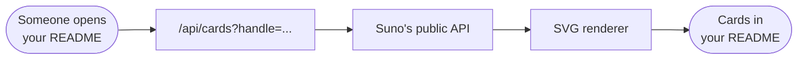

<div align="center">


# Suno Cards

### Your Suno songs, as cards in your GitHub README.

Give it your Suno handle. Get a live image of your profile and your songs.

<a href="https://github-readme-suno-cards.vercel.app/builder"></a> <a href="https://github-readme-suno-cards.vercel.app/gallery"></a> <a href="https://github-readme-suno-cards.vercel.app"></a> <a href="docs/overview.md"></a>

</div>

<br>

<div align="center">
<a href="https://suno.com/@chanmeng666"></a>

<sub>These are the cards themselves, live, for <a href="https://suno.com/@chanmeng666">@chanmeng666</a>.</sub>
</div>

<br>

## Try it

Paste this into your README and replace `YOUR_HANDLE` with your Suno handle:

```markdown
[](https://suno.com/@YOUR_HANDLE)
```

There is nothing to install. The cards follow GitHub's light and dark mode unless you set a theme.

<br>

<div align="center">


<sub>One song: <code>/api/card?id=YOUR_SONG_UUID&layout=player&preset=suno</code></sub>

<br>


<sub>The classic layout: <code>/api/card?id=YOUR_SONG_UUID&theme=light</code></sub>

<br>


<sub>Profile only: <code>/api/profile?handle=YOUR_HANDLE</code></sub>

</div>

<br>

To pick a style by eye, use the [builder](https://github-readme-suno-cards.vercel.app/builder): it previews the card and writes the line for you.

## How it works



It reads only Suno's public endpoints: no login, no scraping. Cards are cached, so new numbers can take up to an hour to show. Suno changes its public API without notice. What changed, and when, is in the [status notes](docs/overview.md#status--upstream-findings-2026-09).

## For your agent

This page is all a person needs. Every parameter, toggle and colour is in the docs, along with the GitHub Action that writes the cards into your README on a schedule. Clone the repo and point your coding agent at [`AGENTS.md`](AGENTS.md) and [`docs/overview.md`](docs/overview.md).

```bash
git clone https://github.com/ChanMeng666/github-readme-suno-cards.git
```

<sub>[Full overview](docs/overview.md) · [Example workflows](examples) · [Changelog](CHANGELOG.md) · [Contributing](CONTRIBUTING.md) · [Security](SECURITY.md) · [MIT](LICENSE)</sub>

<sub>Built by [Chan Meng](https://github.com/ChanMeng666).</sub>
